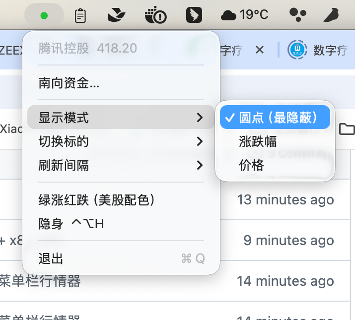
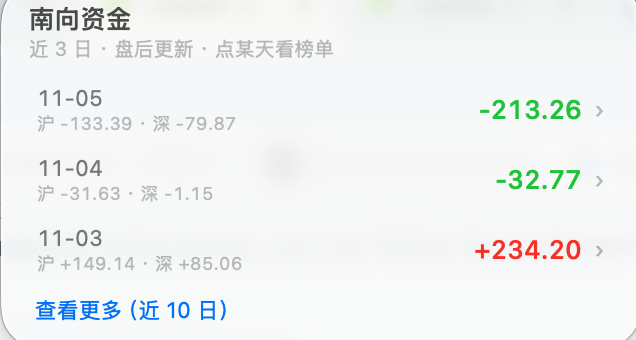
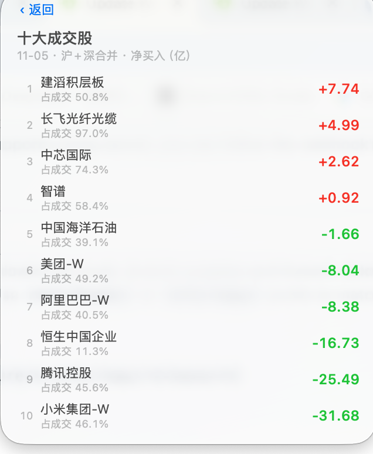

# StealthTicker

> 摸鱼用的港股 / A 股行情器 —— 菜单栏里只有一颗小圆点。

[](https://github.com/mateJay/stealth-ticker/actions/workflows/ci.yml)
[](https://github.com/mateJay/stealth-ticker/releases)
[](https://github.com/mateJay/stealth-ticker)
[](LICENSE)

A tiny macOS menu bar stock ticker for HK / CN markets. It shows a single colored dot,
nothing else — hover for the price, click for details, `⌃⌥H` to hide it instantly.

## 为什么做成这样

上班看行情，真正的问题不是"看不到"，而是"看起来像在摸鱼"。

一个弹窗、一张 K 线图、一条红绿闪烁的行情条，都会在别人路过的那一秒暴露。
所以这个 App 的方向是**寄生在没人会多看一眼的界面角落**：

- 菜单栏里只有一个圆点，和「录制中」「同步中」那种系统指示器长得一样
- 没有窗口、没有 Dock 图标，活动监视器里也只有一行进程
- 想要信息的时候，鼠标悬停或点一下才有

价格默认**不显示**，这是刻意的。

## 它长什么样

**默认只有一颗圆点。** 下图中菜单栏最左边那颗绿点就是它 —— 和电池、Wi-Fi、输入法这些系统指示器
混在一起，不会有人多看一眼：



`显示模式 → 圆点（最隐蔽）` 就是默认值。想看具体数字可以切成「价格」或「涨跌幅」，
但那就容易被看出来了。

点开之后才有多信息 —— 南向资金、十大成交股：

| 南向资金（近 3 日） | 点某一天看成交股 |
| --- | --- |
|  |  |

## 功能

- **菜单栏圆点**：红涨绿跌，颜色即信息；鼠标悬停看价格，左键点开详情面板
- **老板键 `⌃⌥H`**：立刻隐藏，再按一次恢复（全局热键，不需要辅助功能授权）
- **三种显示模式**：圆点 / 涨跌幅 / 价格，右键切换
- **9 个预设**：恒生指数、恒生科技、上证指数、创业板指、腾讯、阿里、美团、小米、港交所；
  也支持自定义代码（`00700` / `600519` / `116.00700` / `100.HSI`）
- **南向资金**：最近 3 个交易日港股通净买入，可展开到 10 日；点某一天进入当日十大成交股
  （沪 + 深合并，按净买入排序）
- **只在交易时段高频刷新**：港股 09:10–12:00 / 13:00–16:10，沪深 09:15–11:30 / 13:00–15:05，
  休市降到 60 秒
- **断网不崩**：保留上一次价格，圆点变灰，恢复后自动继续；重启时从缓存直接显示
- 无第三方依赖，约 1200 行 Swift，`swiftc` 直接编译

## 安装

### 下载 DMG（推荐）

1. 到 [Releases](https://github.com/mateJay/stealth-ticker/releases) 下载最新的 `StealthTicker-x.y.z.dmg`
2. 打开，把 StealthTicker 拖进「应用程序」
3. 首次打开时 macOS 会拦一下，见下一节

### 首次打开被拦怎么办

这个 App 没有 Apple 开发者签名和公证（那需要每年 99 美元），所以 Gatekeeper 会提示
「无法打开，因为 Apple 无法验证」甚至「已损坏」。二选一：

```bash
# 方式一：右键点 App →「打开」→ 再点「打开」
# 方式二：命令行去掉隔离属性
xattr -dr com.apple.quarantine /Applications/StealthTicker.app
```

### 从源码构建

需要 Xcode 或 Command Line Tools（`xcode-select --install`）。

```bash
git clone https://github.com/mateJay/stealth-ticker.git
cd stealth-ticker
./build.sh
open StealthTicker.app
```

打包 DMG：`./scripts/create-dmg.sh`，产物在 `dist/`。

## 使用

| 操作 | 效果 |
| --- | --- |
| 看 | 菜单栏一颗红/绿圆点 |
| 鼠标悬停 | 浮出「名称 价格 涨跌（幅度）时间」 |
| 左键单击 | 详情面板：价格、涨跌、更新时间、是否交易中 |
| 右键单击 | 设置菜单：显示模式 / 切换标的 / 刷新间隔 / 配色 / 南向资金 / 退出 |
| `⌃⌥H` | 隐身，再按恢复 |

右键菜单里的「南向资金…」：默认 3 个交易日，点「查看更多」展开到 10 日，
点某一天进入当日十大成交股榜单，左上角「‹ 返回」退回。

## 数据源

全部来自东方财富的公开接口，免费、无需 API key：

- 实时行情 `push2.eastmoney.com`
- 南向资金 / 十大成交股 `datacenter-web.eastmoney.com`

字段含义、单位换算（金额字段有元、百万元混用）、以及哪些数据已经拿不到，
都整理在 [API-NOTES.md](API-NOTES.md) 里。

## 已知限制

- **菜单栏太挤时会被系统藏起来**。macOS 放不下新状态项时会直接隐藏它，表现是「开了但看不见」。
  关掉几个不常用的菜单栏图标即可；多显示器时状态项会跟随当前菜单栏所在的屏幕。
- **南向资金是日频**。港股收盘（16:00）之后才出当日数据，盘中打开看到的永远是上一交易日；
  沪深港通 2024 年收紧披露后，盘中实时资金流已经没有公开来源了。
- 用的是非官方接口，字段随时可能变。真变了就改 `Sources/QuoteFetcher.swift` 和
  `Sources/Southbound.swift`。
- 只适配了 macOS 13+，没有做沙盒（它是本地工具，不需要上架）。

## 开发

```
Sources/
  main.swift            入口
  AppDelegate.swift     状态栏、菜单、轮询调度、热键
  Market.swift          交易时段判断
  Quote.swift           行情模型
  QuoteFetcher.swift    实时行情抓取
  Southbound.swift      南向资金模型与抓取
  QuotePopover.swift    个股详情面板
  SouthboundPanel.swift 南向资金面板（含下钻）
scripts/
  create-dmg.sh         打 DMG
  build-icon.sh         重新生成 AppIcon.icns
  make-icon.swift       图标绘制脚本
build.sh                编译 App
API-NOTES.md            接口速查
```

调试：`STEALTH_TICKER_DEBUG=1 ./StealthTicker.app/Contents/MacOS/StealthTicker` 会把状态栏几何信息写到
`/tmp/stealth-debug.json`（`open -a` 不会透传环境变量，所以直接跑二进制）。

## License

[MIT](LICENSE)
